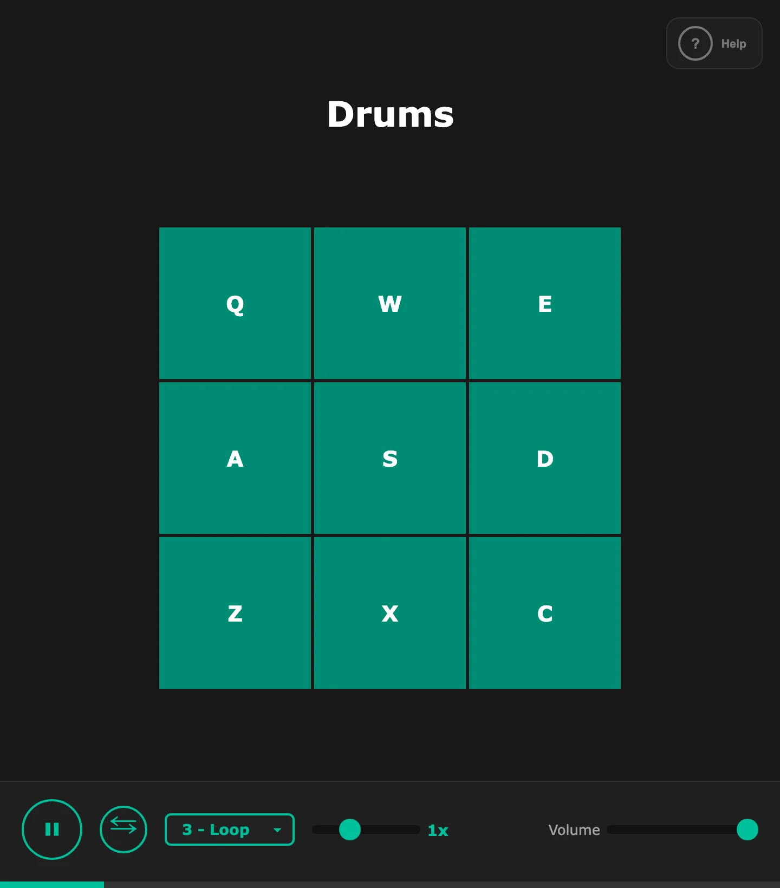

# Drum Machine

Play drums with your keyboard: nine drum pads on the letter keys, and nine looping samples on the number keys that you can pause, slow down, speed up and play backwards.

<p align="center"></p>

- **Nine drum pads.** Press `Q` `W` `E`, `A` `S` `D` or `Z` `X` `C`, or click a pad, to play an 808, a kick, a snare, hats, a clap and more.
- **Nine looping samples.** Press `1` to `9`, or pick one from **-- Select a sample --**, to loop it under your drumming.
- **Speed, reverse and volume.** Change the loop's speed from 0.1x to 3x, play it backwards with **Reverse**, and set the overall **Volume**.

## Getting started

Play it at [gridloc.dev](https://gridloc.dev/apps/drum-machine), or serve this folder from source:

```bash
python3 -m http.server 8000   # then open http://localhost:8000
```

See [Getting started](docs/getting-started.md) for requirements and other ways to run it.

## Learn more

- [Features](docs/features.md) · [Controls](docs/controls.md) · [Credits](docs/credits.md)
- [All documentation](docs/README.md) · [Working on the code](docs/development.md)

## License

[MIT](LICENSE)
