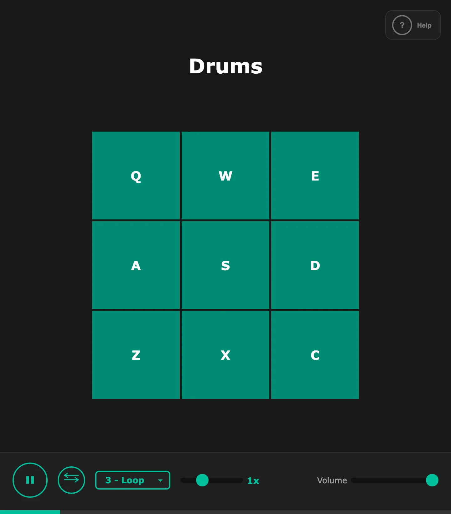

# Features

Drum Machine is a set of drum pads and looping samples you play from the keyboard.

## Drum pads

The **Drums** grid has nine pads, each labeled with its key. Press the key or click the pad to play its sound once; the pad lights up while it plays. Pressing a pad again before it ends layers a new hit on top.

| Key | Sound      |
| --- | ---------- |
| `Q` | 808 1      |
| `W` | 808 2      |
| `E` | Triangle   |
| `A` | Perc       |
| `S` | Closed hat |
| `D` | Clap       |
| `Z` | Kick       |
| `X` | Hi hat     |
| `C` | Snare      |

## Sample loops

Nine loops sit on the number keys `1` to `9`. Press a number, or open **-- Select a sample --** and click a loop (each shows its key), to start it from the beginning. A loop plays over and over until you pick another one, which replaces it. The bar under the toolbar shows how far through the loop you are.

## Transport

The toolbar controls the loop that's playing:

- **▶ / ⏸** pauses the loop and resumes it from the same spot.
- **Reverse** (**⇆**) plays the loop backwards from the mirrored spot, so it carries on without jumping. It stays on for the next loop you pick, and is highlighted while on.
- The speed slider sets how fast the loop plays, from 0.1x to 3x in steps of 0.1. The label beside it shows the speed, and the next loop starts at that speed too. Speed changes the pitch along with the tempo.
- **Volume** sets the volume of everything, drums and loops together.

## Keyboard shortcuts

The **Help** button (**?**, top right) or the `?` key opens **Keyboard Shortcuts**, a list of every key. It closes with `Esc`, the **×** button, `?` again, or a click outside it. While it's open, the other keys do nothing. See [Controls](controls.md) for the full list.
